# UPI Gateway


**Live demo:** <https://upi-gateway-gamma.vercel.app> · **Code:** <https://github.com/lostingness/UPI>

## What it is

UPI Gateway lets a shop accept UPI payments through its **own** UPI ID or payment-gateway account. A customer scans a QR code (or taps a payment link), pays, and the money goes **straight into the shop's own bank account**. The gateway never holds the money. It only checks the payment and tells the shop's system what happened.

It is built for:

- **Small shops** who want a payment link or QR code without paying an aggregator a fee on every sale.
- **Developers** who want a simple `POST /api/v1/orders` API, signed webhooks, and a sandbox to test with — no real money, no provider calls.
- **Anyone who wants to own their data** — orders, accounts, and logs live in your own Neon Postgres database.

Tech: Next.js 16 + TypeScript (App Router) on Vercel, Neon Postgres, no Supabase, no PHP. This is a port of the Laravel 12 original ([`mynkdev-21/upi-gateway`](https://github.com/mynkdev-21/upi-gateway), MIT, commit `7189511`).

## The one rule

> **A payment is never trusted from the customer, the browser, or a UTR alone.**

An order becomes `paid` only when **all** of these match a provider response — exact amount, order ID, currency (`INR`), and a fresh timestamp — **or** when the merchant approves a customer-submitted UTR against their bank statement, **or** when an admin does an audited manual override. A 12-digit UTR typed into a form proves nothing by itself. It goes to review until a human approves it.

## Quick start

```bash
git clone https://github.com/lostingness/UPI.git
cd UPI
npm install
cp .env.example .env.local   # fill in real values (never commit .env.local)
npm run migrate              # creates the tables in your Neon database
npm run dev                  # http://localhost:3000
```

First run: open `/setup` and create the first admin. After that, `/setup` refuses with 409 — setup runs once.

### Settings you must fill in

See [`.env.example`](.env.example) — placeholders only, never real values.

| Setting | What it is |
|---|---|
| `DATABASE_URL` | Your Neon **pooled** connection string. Keep it secret. |
| `SESSION_SECRET` | Signs the login cookie. Make a fresh one: `openssl rand -base64 48`. |
| `ENCRYPTION_KEY` | 32-byte key for stored secrets (AES-256-GCM). `openssl rand -base64 32`. |
| `CRON_SECRET` | Protects `/api/cron/*`. `openssl rand -hex 32`. |
| `APP_URL` | The public URL of your deployment. |
| `ALLOW_REGISTRATION` | `false` (default). Set `true` only to open merchant signups. See [Merchant signups](#merchant-signups) below. |

Other useful settings: `GATEWAY_ORDER_EXPIRY_MINUTES` (15), `GATEWAY_QR_METHOD` (`same` / `unique`), `GATEWAY_QR_INCREMENT_PAISE` (1–99, default `1`), `GATEWAY_LATE_PAYMENT_GRACE_HOURS` (24). Full list in `.env.example`.

### Database

Create a Neon Postgres project and set its **pooled** connection string as `DATABASE_URL`. Then run the migrations (001–015, plain SQL, safe to re-run):

```bash
npm run migrate
# or: for f in db/migrations/*.sql; do psql "$DATABASE_URL" -f "$f"; done
# or paste each file, in order, into the Neon SQL editor
```

See [`db/README.md`](db/README.md) for the full table map. Money is `NUMERIC(12,2)` (exact to the paise). Times are UTC in the database, IST on screen.

## QR payments: two ways

Every order gets its own QR code with the exact amount in it. The merchant picks a method in Settings → QR.

### Same Amount QR (default)

Every QR shows the order amount — ₹499.00 for one customer, ₹499.00 for the next. Good for a shop counter, a printed sign, or a fixed price (a ₹99 item, a ₹299 ticket, a ₹101 donation). Two orders for the same amount can only be told apart by the order reference or by UTR review.

### Unique Amount QR

Each live order gets a **slightly different amount, a few paise above the order amount**. Example: a ₹500.00 order becomes **₹500.01** for one customer, **₹500.02** for the next. The customer must pay that exact amount — the QR code and the UPI link both carry it, and the pay screen says **"Pay exactly ₹500.02"** in big letters.

Why? The small difference in amount is the only link between a bank-statement entry and an order. It lets the merchant match a payment by amount alone. It is **not** proof by itself — see [How a payment is verified](#how-a-payment-is-verified).

Rules that keep it honest:

- **Exact paise math only.** Amounts use whole paise (`Math.round(amount × 100)`). `₹500.005` is rejected with 422, never rounded.
- **Never more than ₹1.00 above the order amount**, and at most 100 tries to find a free amount. If every amount nearby is taken, order creation fails with **409** and no order is left behind. It never falls back to a duplicate amount.
- **Amounts free up again** when an order is paid, expires, or fails.
- **A customer can change the amount in their UPI app.** If the paid amount is not the payable amount, verification **rejects** it. The order stays pending or in review. The gateway never accepts the base amount when a different amount was paid.
- **For manual (P2P) UPI accounts there is no provider check.** The unique amount is the only matching signal, and the payment still needs a merchant UTR approval. Auto-confirm is impossible without a provider status API.

## How a payment is verified

1. **Customer pays** by QR code, UPI app button, or a hosted checkout (Paytm PG / PhonePe PG).
2. **Provider check.** The gateway asks the provider for the payment status and needs all four to match: exact amount, order ID, currency, and a fresh timestamp. A wrong amount is rejected.
3. **Or UTR review.** The customer submits their 12-digit UTR. The order goes to `review`. The merchant checks it against their bank statement and approves or rejects it in the dashboard.
4. **Or admin override.** An admin can mark a payment manually — only with a password confirmation, and every override is written to an append-only audit log.

What the gateway will **never** do: mark an order paid from a UTR alone, from the browser, or from a customer saying "I paid". The `POST /api/orders/[orderNo]/mark-paid` route is a disabled stub on purpose — it always errors.

Other facts:

- Orders expire after 15 minutes by default. A late payment can still be caught for 24 hours (grace window) — the pay page says so and keeps checking.
- Live orders are `ORD…`, sandbox orders are `TST…`. Sandbox orders never touch a provider. The sandbox can pretend to be six outcomes: success, failure, pending, expiry, timeout, invalid reference.
- Amounts: ₹1 to ₹1,00,000, up to 2 decimals.
- The dashboard has a notification bell: new payments, new orders, UTR submissions, and expiries show up there. Payment sounds are optional — a short chime when a payment lands, a tick when an order is created. Sounds stay silent until you tap anything on the page (a browser rule), and the speaker button next to the bell mutes them.

## Screenshots

Captured 12 November 2026 from a real production build — desktop 1280 px and a true phone width of 390 px. The landing, login, docs, and setup shots below are fresh Round 6 captures (12 Nov 2026) of the Halden rebuild. The merchant screens (pay, dashboard, QR settings, order detail) are still the Round 4 captures against the real Neon database with a disposable demo merchant ("Demo Store", deleted after the capture). The numbers there are real database rows, not made up.

> Note: these Round 6 shots were taken in this machine's Chromium, which cannot reach Google Fonts or the ship-photo host — so they show system fallback fonts and an empty ship-photo area. On a real phone or browser the Inter Tight font loads and the fjord ship photo shows (both URLs return 200). The layout, colours, and spacing in the shots are exact.

> Note: the pay screen changed after these shots were taken. Round 4 (11 Nov 2026) made the whole pay screen fit on one phone screen — smaller QR, countdown as a small chip, one row of UPI-app buttons. New pay screenshots will replace `pay-mobile.jpg` / `pay-desktop.jpg` after the next database-backed capture.

### Landing page

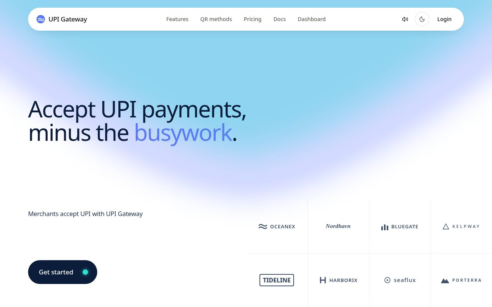

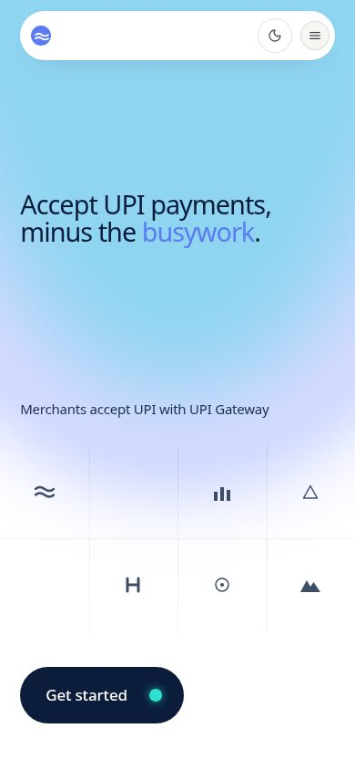

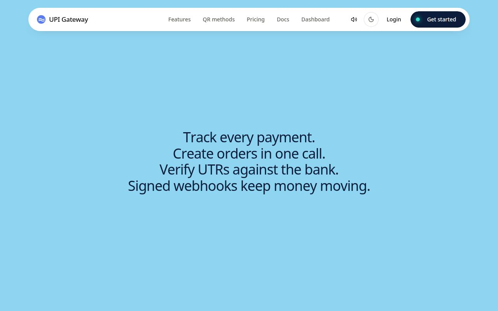

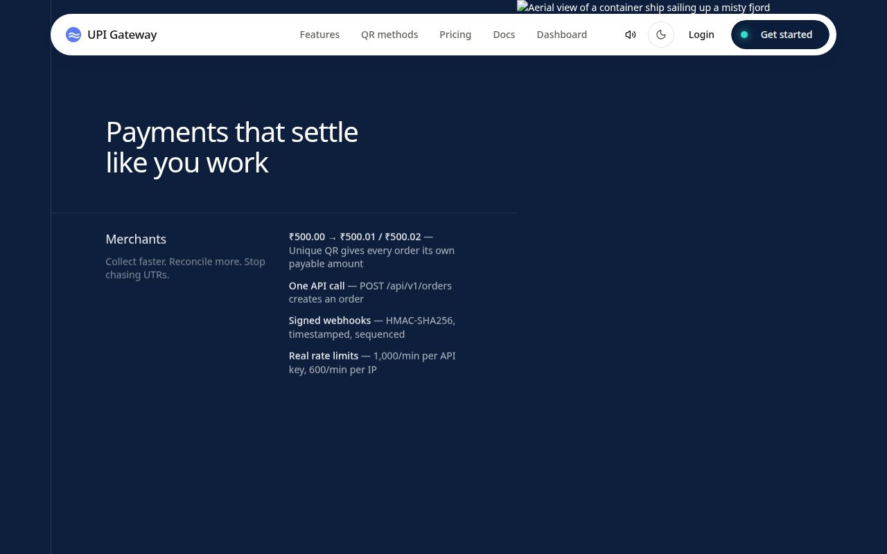

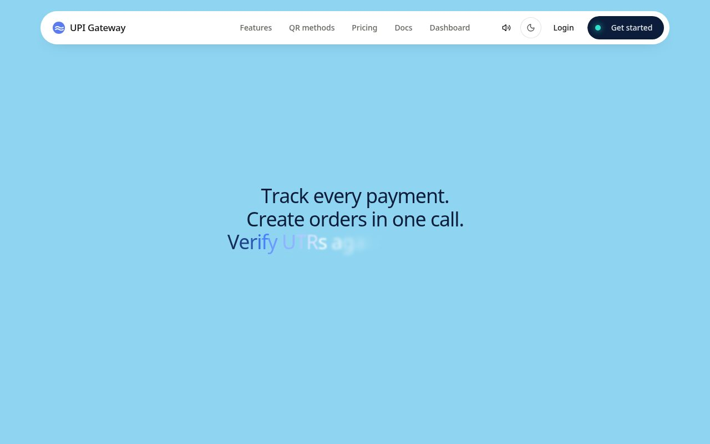

### Pay screen (before the Round 4 compact redesign)

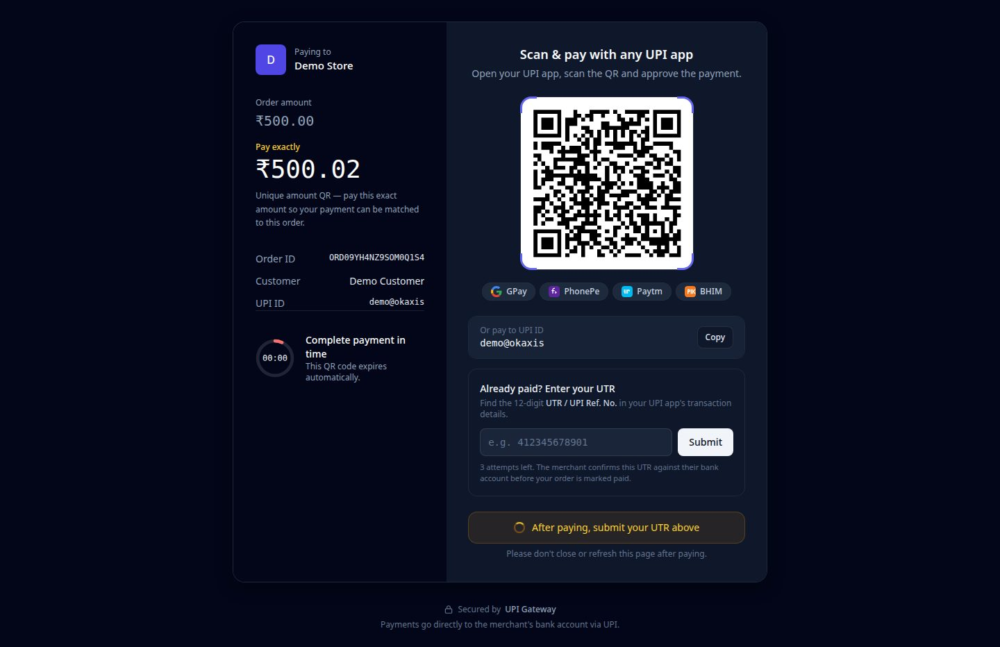

*Pay screen for a real ₹500.00 order (desktop): "Order amount ₹500.00 / **Pay exactly ₹500.02**" — the payable amount (base + 2 paise) is what the QR and the UPI link carry.*

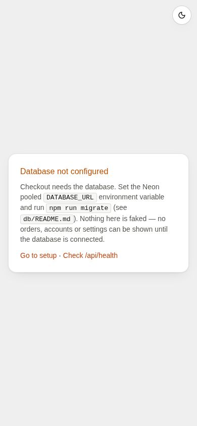

### Merchant dashboard

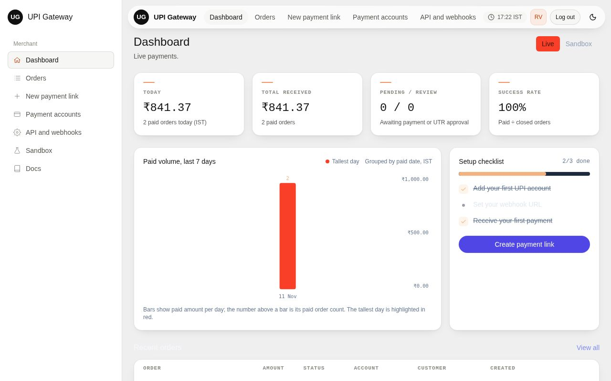

*Today ₹500.00, Total received ₹500.00, Pending / Review 2 / 1, success rate 100%, and the real recent-orders table.*

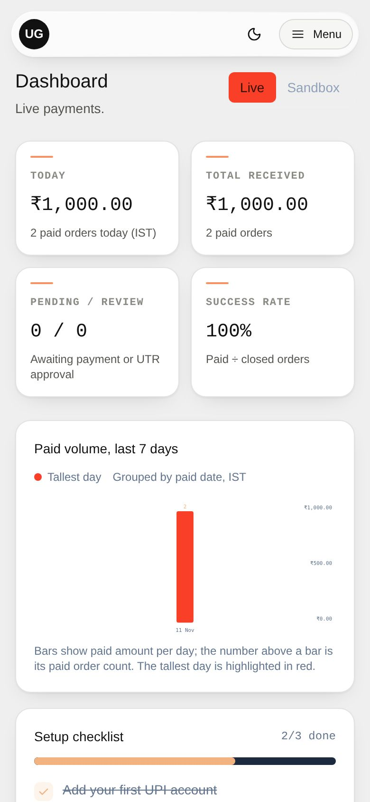

### QR settings, login, docs, setup, order detail

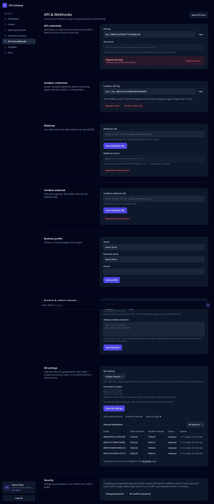

*Settings → QR: method "Unique amount", increment 1 paise, and the Amount allocations table — four released allocations (₹500.01, ₹500.02, ₹250.01, ₹750.01). The API keys in this shot belonged to the deleted demo merchant.*

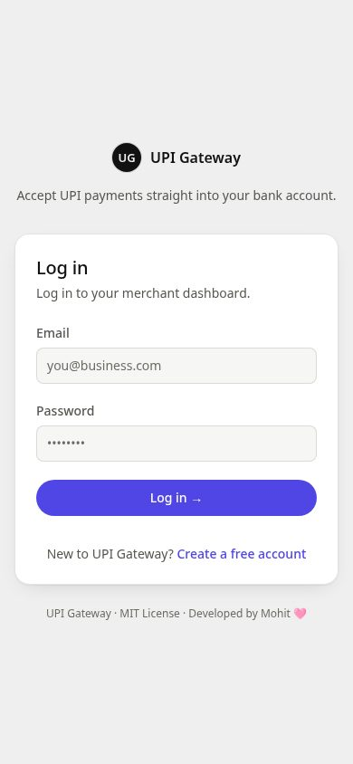

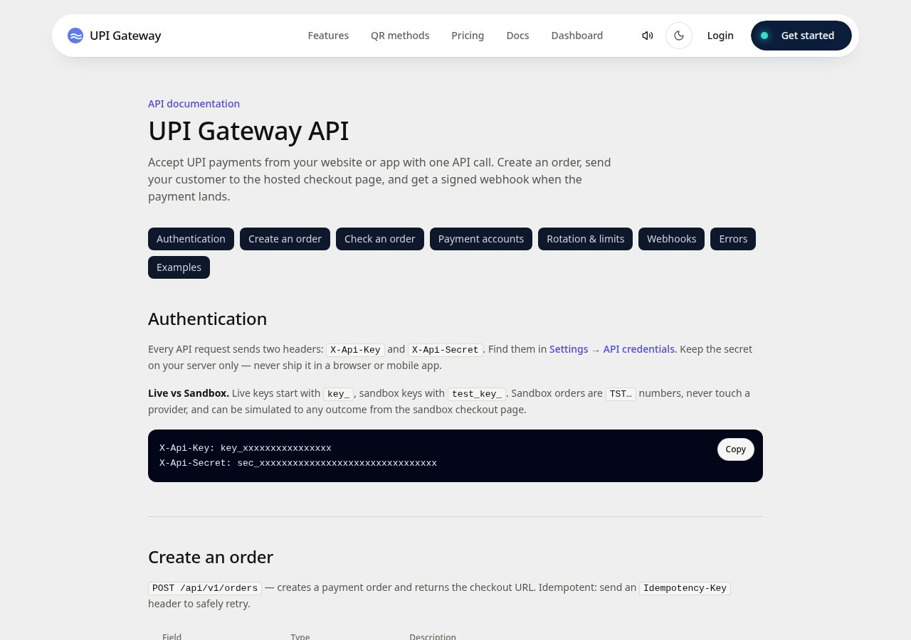

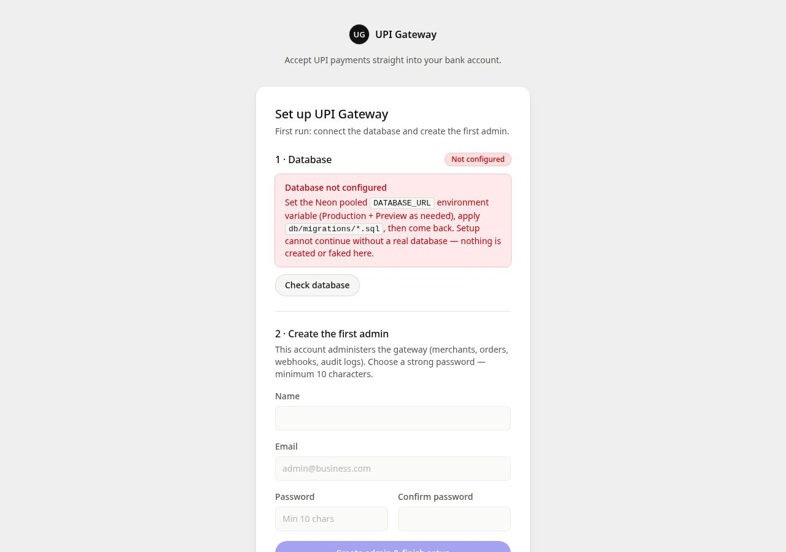

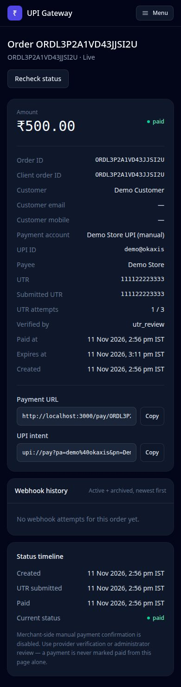

## Deploy on Vercel

1. Import the repo into Vercel (framework: Next.js).
2. Set `DATABASE_URL`, `SESSION_SECRET`, `ENCRYPTION_KEY`, and `CRON_SECRET` as **sensitive** env vars (Production + Preview as needed). Set `APP_URL` to the deployment's public URL.
3. **Turn SSO protection off** for the project if you want the public landing page, docs, and pay links to open (Vercel's SSO / Deployment Protection would otherwise put a login in front of every page).
4. Run the migrations against your Neon database (`npm run migrate` with `DATABASE_URL` set, or via the Neon SQL editor).
5. Visit `/setup` and create the first admin.

Crons are declared in [`vercel.json`](vercel.json) — 01:00 order checks, 02:00 webhook dispatch, 03:00 offload, 04:00 prune (once daily on the Hobby plan; per-minute on Pro). Cron endpoints need `Authorization: Bearer $CRON_SECRET`.

**Costs, stated plainly.** The software is free (MIT). Vercel's Hobby plan is free with limits (including one cron run per day). Neon has a free tier with limits. Neither is "free forever" — check their current plans. Paytm and PhonePe charge the merchant directly; the gateway adds no fee of its own.

### Merchant signups

Signups are **off** by default. To open them, set this env var in Vercel (Production, plain — not sensitive):

| Setting | Value |
|---|---|
| `ALLOW_REGISTRATION` | `true` |

Then redeploy. `/register` shows the signup form, and `POST /api/auth/register` creates a new account. New accounts are always **merchants** — this form can never create an admin. The first admin is created only at `/setup`, once. Set the var back to `false` (and redeploy) to close signups again.

## API

Full reference: [`/docs`](https://upi-gateway-gamma.vercel.app/docs) on the live site.

Every API request sends two headers — `X-Api-Key` and `X-Api-Secret` — from Settings → API credentials. Keep the secret on your server only, never in a browser or mobile app. Live keys start with `key_`, sandbox keys with `test_key_`.

### Create an order

```bash
curl -X POST $APP_URL/api/v1/orders \
  -H "X-Api-Key: $UPI_API_KEY" \
  -H "X-Api-Secret: $UPI_API_SECRET" \
  -H "Idempotency-Key: order-1001" \
  -d '{
    "amount": "499.00",
    "currency": "INR",
    "client_order_id": "order-1001",
    "customer": { "name": "Asha Verma", "email": "asha@example.com" },
    "redirect_url": "https://shop.example.com/thanks"
  }'
```

| Field | Notes |
|---|---|
| `amount` | Required. ₹1–₹1,00,000, up to 2 decimals. |
| `client_order_id` | Required. Your unique reference (letters, digits, `_`, `-`, up to 64 chars). Reusing one returns **409**. |
| `payment_account_id` | Optional. Pay into this account; otherwise rotation picks one. Not allowed in sandbox. |
| `customer_name` / `customer_email` / `customer_mobile` | Optional. |
| `note` | Optional, up to 50 chars. Shown on the pay screen and in the UPI link. |
| `redirect_url` | Optional. The domain must be allowlisted in Settings first. |

Response — `201 {success: true, data: …}` with `order_id`, `payment_url` (`https://your-gateway.example/pay/ORD…`), `upi_intent`, `expires_at`, and more. Every response carries an `X-Request-Id` header — include it when reporting a problem.

### Other endpoints

- `GET /api/health` — `{status, database_configured}` (no secrets).
- `GET /api/v1/orders/[orderNo]` — by `order_no` or your `client_order_id`. Re-checks the provider first, so the status is fresh. Statuses: `pending`, `paid`, `review`, `expired`, `failed`.
- `GET /api/v1/accounts` — your UPI accounts with `used_today` / `remaining_today` against each daily limit.
- Merchant reads (session login, your data only): `GET /api/orders`, `GET /api/orders/[orderNo]`, `GET /api/dashboard/stats`, `GET /api/settings`.
- Checkout (public): `GET /api/pay/[orderNo]/status`, `POST /api/pay/[orderNo]/utr`, `POST /api/pay/[orderNo]/start`, `GET /api/pay/[orderNo]/qr` (PNG).
- Sandbox: `POST /api/sandbox/pay/[orderNo]/simulate`.
- Auth: `POST /api/auth/login`, `POST /api/auth/logout`, `POST /api/auth/register` (flag-gated), `POST /api/auth/confirm-password`.
- Admin (session + role=admin + password confirmed in the last 15 minutes): orders, merchants, accounts, webhooks, audit logs, transaction debugger, manual payment override.

Errors: `401` bad key/secret · `403` merchant disabled (or someone else's data) · `404` not found · `409` duplicate `client_order_id` / no unique amount free · `422` bad input (see `errors`) · `429` rate limited (respect `Retry-After`) · `500` server error (retry with the same `Idempotency-Key`).

## Webhooks

Every paid, expired, under-review, failed, pending, and timeout change is sent to your webhook URL as signed JSON: `order.paid`, `order.expired`, `order.under_review`, `order.failed`, `order.pending`, `order.timeout`.

**Check the signature.** Each delivery carries a header like `t=1731300612,v1=…` where `v1 = HMAC-SHA256(webhook_secret, t + "." + raw_body)`. Accept only timestamps within **5 minutes** of now, compare in constant time, and ignore an `event_id` you have already seen.

**Delivery and retries.** Events go into a durable outbox and are delivered by the dispatcher cron, with backoff — **30 s, 2 min, 10 min, 30 min, 1 h** — up to 6 tries. Failed deliveries can be retried from the admin UI. Logs are kept 30 days by default (`WEBHOOK_RETENTION_DAYS`).

> **Deadline: 31 March 2027.** Timestamped signatures (`t=…,v1=…`) are the only supported scheme after this date. The old `X-Signature-Legacy` header is retired — check the timestamped signature now.

## Troubleshooting

| Problem | What to do |
|---|---|
| `Database not configured` on the landing page, `/setup`, or `/pay/*` | `DATABASE_URL` is missing or wrong. Set the Neon **pooled** connection string, then re-check. `GET /api/health` reports `database_configured`. |
| `/setup` returns 409 | The gateway is already installed (a first admin exists). By design — setup runs once. |
| `409` on `POST /api/v1/orders` | Either the `client_order_id` was already used, or (Unique Amount QR) every amount within ₹1.00 is taken. For the second case, retry in a few minutes — amounts free up when orders expire or are paid. |
| `422` "account not found" on order creation | The `payment_account_id` does not exist or belongs to another merchant. Leave it out and let rotation pick one. |
| `422` "Amount must have at most 2 decimal places" | Amounts are exact to the paise (e.g. `499.00`). `500.005` is rejected, never rounded. |
| Cron endpoints return 401 | The request needs `Authorization: Bearer $CRON_SECRET`. Vercel sends this for scheduled crons; manual calls must include it. |
| Webhooks not arriving | Check the outbox: admin → Webhooks shows each event's tries. On Hobby, dispatch runs once daily (02:00) — use `POST /api/webhooks/outbox/dispatch` (admin) or the admin UI retry to send now. |
| Orders stay pending after a manual UPI payment | Expected without a provider API: the gateway cannot see a manual payment by itself. The customer submits their UTR, and the merchant approves it in the dashboard. |
| Tables missing after deploy | Run `npm run migrate`. Most tables are also created on first use, but the migration files are the source of truth — run them once per fresh database. |
| `mark-paid` always errors | Deliberate. That route is a disabled stub. There is no API that marks an order paid without proof. Use UTR approval or the audited admin override. |

## Tests

```bash
npm test            # vitest run
```

All tests in `tests/` are **mocked** (pure crypto/validation, injected fetch, in-memory idempotency store). They cover: Paytm checksum, webhook HMAC signature (valid / tampered / stale), SafeUrl SSRF rules, UTR-alone-does-not-mark-paid, order-creation idempotency, authz boundary, and the three verifiers (paid only when all checks match). **Live tests against the real Neon database are still owed**: create order → sandbox simulate success → webhook delivered + signed → order paid; provider verify rejects wrong amount; UTR approve/reject; admin override; rate limits; installer blocked after install; outbox retry after failure.

## Security

- **Never paid on UTR alone.** Only a provider response (amount + order ID + currency + fresh timestamp), a merchant UTR approval, or an audited admin override marks an order paid.
- **Webhook signing.** HMAC-SHA256 over `timestamp + "." + raw_body`, 5-minute tolerance, constant-time compare, ignore duplicate `event_id`.
- **SSRF hardening.** Webhook and redirect URLs are re-checked right before sending — fresh DNS lookup, all answers must be public IPs (no private / loopback / link-local ranges).
- **Redirect allowlist.** A customer returns only to a domain the merchant allowlisted in Settings. Anything else is refused.
- **Rate limits.** Order creation: 1000/min per API key, 600/min per IP; general API: 120/min per key; failed logins: 30/min per IP. Idempotency keys are kept 24 h.
- **Sessions.** Stateless signed JWT (HS256) in an `httpOnly`, `Secure`-in-production, `SameSite=lax` cookie, **120-minute** lifetime. The token holds part of the password hash, so changing the password logs out all sessions. Admin pages also need a password confirmation within the last 15 minutes.
- **Secrets at rest.** Provider credentials and API secrets are stored AES-256-GCM encrypted in the merchant's own database (`ENCRYPTION_KEY`). Never logged, never returned by any API.
- **What this is not.** There is no password-reset flow (the source never had one, and none was invented). The Paytm Business status API is unofficial and may change without notice. With no provider credentials set up, verification returns "provider not configured" and orders stay pending — no fake payments, ever.

## License

MIT — Copyright (c) 2026 Mayank Singh; Copyright (c) 2026 Mohsin Khan. See [`LICENSE`](LICENSE).

## Credits

- Original Laravel 12 project: [`mynkdev-21/upi-gateway`](https://github.com/mynkdev-21/upi-gateway) (MIT) — this is a Next.js + TypeScript + Neon Postgres port of that work, keeping its verification rules, webhook format, and API shape.
- The live deployment, redesign, and this port were built for the merchant-facing release by Mohit.

---

<p align="center"><sub>Developed by Mohit 🩷</sub></p>
