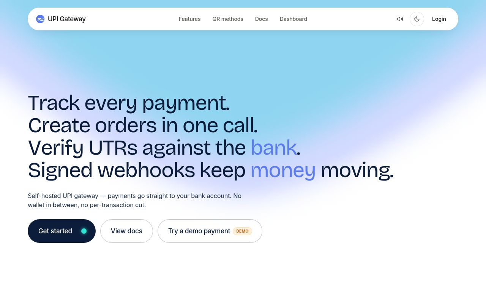
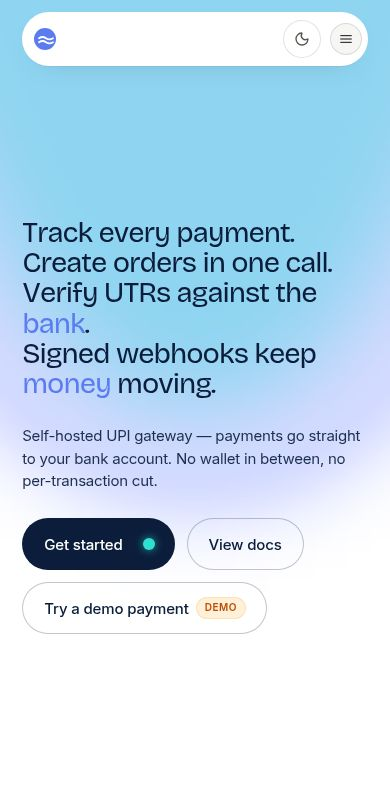
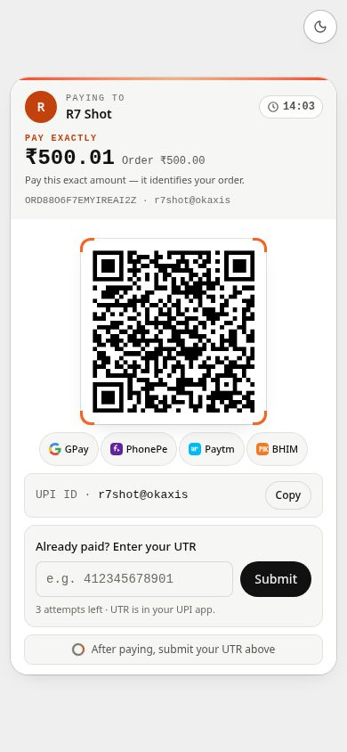
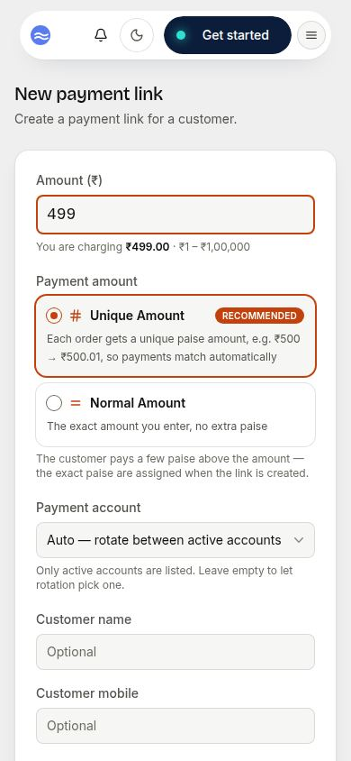
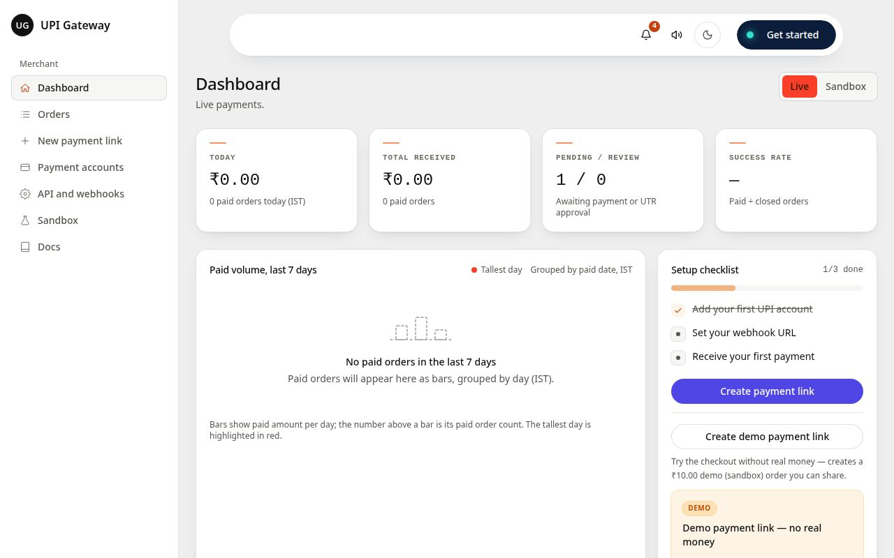
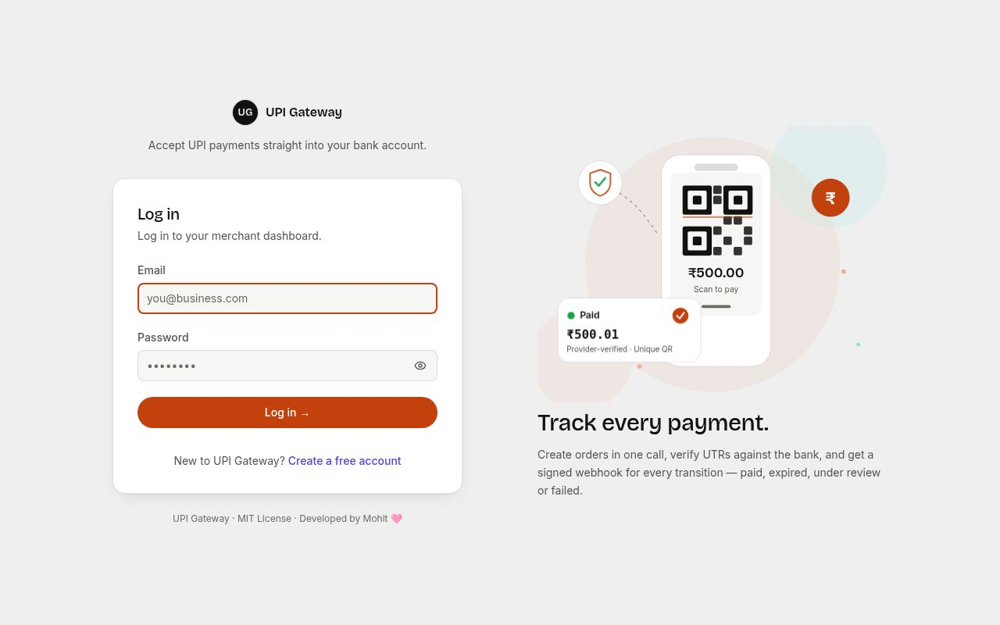

# UPI Gateway

    

> **Accept UPI payments straight into your own bank account. No middleman, no fee on every sale.**

**🔴 Live demo:** <https://upi-gateway-gamma.vercel.app> · **🧪 Try a demo payment** on the live site — a ₹10 demo order, sandbox only, clearly marked DEMO, no real money ever moves.


## What it is

UPI Gateway is a self-hosted payment gateway for UPI. A customer scans your QR code or taps your payment link, pays with any UPI app, and the money goes **straight into your bank account**. The gateway never holds the money — it only checks the payment and tells your system what happened.

Built for **small shops** (a payment link or QR code without an aggregator's cut), **developers** (one simple API, signed webhooks, a sandbox), and **anyone who wants to own their data** (orders, accounts, and logs in your own Neon Postgres database).

Tech: Next.js 16 + TypeScript on Vercel, Neon Postgres.

## Screenshots

Captured 12 November 2026 from a real production build. Desktop 1280 px, phone 390 px. (Taken in this machine's Chromium, so the Bricolage / Inter fonts show as a system fallback here — on a real browser they load.)

| Landing, desktop | Landing, phone | Pay screen, phone |
|---|---|---|
|  |  |  |
| **New order, phone** | **Dashboard, desktop** | **Log in, desktop** |
|  |  |  |

## Features

- **Your own UPI ID** — payments land in your bank account, not a wallet.
- **QR codes + payment links** — one link per order, shareable anywhere, in two QR methods (see below).
- **UTR review** — customers submit their 12-digit UTR; you approve it against your bank statement.
- **Signed webhooks** — every payment event, delivered with an HMAC signature.
- **Sandbox + demo links** — test everything with fake orders, no real money.
- **Dashboard** — orders, accounts, stats, and a notification bell for new payments.
- **Sounds** — a short sound plays when an order is created or a payment arrives (mutable, real MP3 files in `public/sounds/`).

## Two ways to take a payment

Every order gets its own QR code with the exact amount in it. You pick the method when you create an order (Unique is preselected) or in Settings → QR.

### Unique Amount (default)

Each order gets a **slightly different amount, a few paise above the order amount**. A ₹500.00 order becomes **₹500.01** for one customer, **₹500.02** for the next. The customer must pay that exact amount — the pay screen says **"Pay exactly ₹500.01"** in big letters.

Why? The small difference is the link between a bank-statement entry and an order. It lets you match a payment by amount alone. It is **not** proof by itself — a payment is only trusted after a provider check or your UTR approval (see Security).

### Normal Amount

The exact amount you enter, no extra paise — ₹500.00 for everyone. Good for a shop counter, a printed sign, or a fixed price (a ₹99 item, a ₹299 ticket). Two orders for the same amount can only be told apart by the order number or by UTR review.

Rules: amounts use exact paise math (₹500.005 is rejected, never rounded). A Unique amount is never more than ₹1.00 above the order amount, and at most 100 tries are made to find a free one — if all are taken, order creation fails cleanly with 409. Amounts free up again when an order is paid, expires, or fails.

## Easy setup

You need: **Node.js 20+**, **npm**, and a free **Neon Postgres** account.

### 1. Get the code

```bash
git clone https://github.com/lostingness/UPI.git
cd UPI
npm install
```

### 2. Add your secrets

```bash
cp .env.example .env.local   # fill in real values — never commit .env.local
```

| Setting | What it is |
|---|---|
| `DATABASE_URL` | Your Neon **pooled** connection string. Keep it secret. |
| `SESSION_SECRET` | Signs the login cookie. Make one: `openssl rand -base64 48` |
| `ENCRYPTION_KEY` | 32-byte key for stored secrets. Make one: `openssl rand -base64 32` |
| `CRON_SECRET` | Protects `/api/cron/*`. Make one: `openssl rand -hex 32` |
| `APP_URL` | The public URL of your deployment, e.g. `https://your-domain.example` |
| `ALLOW_REGISTRATION` | `false` (default). Set `true` only to open merchant signups. |

Everything else has a safe default. The full list is in [`.env.example`](.env.example) — placeholders only, never real values.

### 3. Make the tables

```bash
npm run migrate   # creates the tables in your Neon database
```

### 4. Run it

```bash
npm run dev   # open http://localhost:3000
```

### 5. Create the first admin

Open `/setup` and create the first admin account. After that, `/setup` refuses with 409 — setup runs once, by design.

That's it. You are ready to take payments.

## Deploy on Vercel

1. Import the repo into Vercel (framework: Next.js).
2. Set `DATABASE_URL`, `SESSION_SECRET`, `ENCRYPTION_KEY`, and `CRON_SECRET` as **sensitive** env vars. Set `APP_URL` to the deployment's public URL.
3. **Turn SSO / Deployment Protection off** for the project — otherwise Vercel puts a login in front of every page, including your pay links.
4. Run the migrations against your Neon database (`npm run migrate` with `DATABASE_URL` set, or paste the files from `db/migrations/` into the Neon SQL editor, in order).
5. Visit `/setup` and create the first admin.

Crons live in [`vercel.json`](vercel.json) — 01:00 order checks, 02:00 webhook dispatch, 03:00 offload, 04:00 prune (once daily on the Hobby plan; per-minute on Pro). Cron endpoints need `Authorization: Bearer $CRON_SECRET`.

**Costs, stated plainly.** The software is free (MIT). Vercel Hobby and Neon both have free tiers with limits — check their current plans. Paytm and PhonePe charge the merchant directly; the gateway adds no fee of its own.

### Merchant signups

Signups are **off** by default. To open them, set `ALLOW_REGISTRATION` to `true` in Vercel (plain — not sensitive) and redeploy. New accounts are always **merchants** — this form can never create an admin. Set it back to `false` (and redeploy) to close signups again.

## Try it without real money

- **Demo payment link** — on the landing page ("Try a demo payment") or in the dashboard ("Create demo payment link"). It creates a sandbox order for a fixed ₹10.00 and gives you a shareable link. The demo page is labelled DEMO everywhere and never moves real money.
- **Sandbox** — sandbox orders start with `TST…` (live orders start with `ORD…`). They never touch a provider. The sandbox can pretend to be six outcomes: success, failure, pending, expiry, timeout, invalid reference. Get sandbox API keys in Settings → API credentials (they start with `test_key_`).

## API quickstart

Full reference: [`/docs`](https://upi-gateway-gamma.vercel.app/docs) on the live site.

Every API request sends two headers — `X-Api-Key` and `X-Api-Secret` — from Settings → API credentials. Keep the secret on your server only, never in a browser or mobile app. Live keys start with `key_`, sandbox keys with `test_key_`.

### Create an order

```bash
curl -X POST $APP_URL/api/v1/orders \
  -H "X-Api-Key: $UPI_API_KEY" \
  -H "X-Api-Secret: $UPI_API_SECRET" \
  -H "Idempotency-Key: order-1001" \
  -d '{"amount": "499.00", "currency": "INR", "client_order_id": "order-1001",
       "customer": {"name": "Asha Verma", "email": "asha@example.com"},
       "redirect_url": "https://shop.example.com/thanks"}'
```

Response — `201 {success: true, data: …}` with `order_id`, `payment_url`, `upi_intent`, and `expires_at`. Every response carries an `X-Request-Id` header — include it when reporting a problem.

| Field | Notes |
|---|---|
| `amount` | Required. ₹1–₹1,00,000, up to 2 decimals. |
| `client_order_id` | Required. Your unique reference. Reusing one returns **409**. |
| `qr_method` | Optional. `unique` (default) or `normal` — per-order, overrides Settings → QR. |
| `payment_account_id` | Optional. Pay into this account; otherwise rotation picks one. |

`customer_name`, `customer_email`, `customer_mobile`, `note` (up to 50 chars), and `redirect_url` are all optional. The redirect domain must be allowlisted in Settings first.

### Other endpoints

- `GET /api/health` — `{status, database_configured}` (no secrets).
- `GET /api/v1/orders/[orderNo]` — by `order_no` or your `client_order_id`. Re-checks the provider first, so the status is fresh. Statuses: `pending`, `paid`, `review`, `expired`, `failed`.
- `GET /api/v1/accounts` — your UPI accounts with `used_today` / `remaining_today`.
- Checkout (public): `GET /api/pay/[orderNo]/status`, `POST /api/pay/[orderNo]/utr`, `POST /api/pay/[orderNo]/start`, `GET /api/pay/[orderNo]/qr` (PNG). Sandbox: `POST /api/sandbox/pay/[orderNo]/simulate`.
- Webhooks: `order.paid`, `order.expired`, `order.under_review`, `order.failed`, `order.pending`, `order.timeout` — signed JSON, HMAC-SHA256 over `timestamp + "." + raw_body`, 5-minute tolerance. Events sit in a durable outbox and retry with backoff (30 s, 2 min, 10 min, 30 min, 1 h — up to 6 tries).

Errors: `401` bad key/secret · `403` someone else's data (or disabled merchant) · `404` not found · `409` duplicate `client_order_id` / no unique amount free · `422` bad input · `429` rate limited (respect `Retry-After`) · `500` server error (retry with the same `Idempotency-Key`).

## Security

- **Never paid on a UTR alone.** Only a provider response (exact amount + order ID + currency + fresh timestamp), a merchant UTR approval, or an audited admin override marks an order paid.
- **Payer tokens.** Loading a pay page mints short-lived, single-use tokens bound to that order. A UTR submit or a fresh hosted-checkout start needs its token; without one the request is refused (401) and the order is untouched.
- **Cross-merchant isolation.** Every order, account, and UTR check is scoped to the logged-in merchant in SQL. Another merchant's order reads as 404 — the same 404 as a nonexistent order.
- **Webhook signing + SSRF hardening.** HMAC-SHA256, 5-minute tolerance, constant-time compare, duplicate `event_id` ignored. Webhook and redirect URLs are re-checked before sending (public IPs only) and redirects go only to domains you allowlisted.
- **Secrets at rest.** Provider credentials and API secrets are stored AES-256-GCM encrypted in your own database. Never logged, never returned by any API.
- **What this is not.** There is no password-reset flow. The Paytm Business status API is unofficial and may change without notice. With no provider credentials set up, verification returns "provider not configured" and orders stay pending — no fake payments, ever.

## Tests

```bash
npm test   # vitest run — 243 tests, all passing
```

- **Unit tests (mocked):** Paytm checksum, webhook HMAC (valid / tampered / stale), SSRF rules, UTR-alone-does-not-mark-paid, order-creation idempotency, authz boundary, the three verifiers, payer-token and pay-surface policies, order methods, MP3 sound wiring.
- **Live tests (Round 7, real Neon DB):** 13/13 passed with two throwaway merchants — cross-order reads 404, foreign account 422, UTR without token 401 with the order unchanged, UTR with token → review, consumed-token replay 401, hosted start without token 401, start budget exhausted → 429, foreign approve/reject 404.

## Troubleshooting

| Problem | What to do |
|---|---|
| `Database not configured` on the landing page, `/setup`, or `/pay/*` | `DATABASE_URL` is missing or wrong. Set the Neon **pooled** connection string, then re-check. `GET /api/health` reports `database_configured`. |
| `/setup` returns 409 | The gateway is already installed. By design — setup runs once. |
| `409` on `POST /api/v1/orders` | Either the `client_order_id` was already used, or (Unique Amount) every amount within ₹1.00 is taken. Retry in a few minutes — amounts free up when orders expire or are paid. |
| `422` "account not found" on order creation | The `payment_account_id` does not exist or belongs to another merchant. Leave it out and let rotation pick one. |
| `422` "Amount must have at most 2 decimal places" | Amounts are exact to the paise (e.g. `499.00`). `500.005` is rejected, never rounded. |
| Orders stay pending after a manual UPI payment | Expected without a provider API: the gateway cannot see a manual payment by itself. The customer submits their UTR, and you approve it in the dashboard. |
| `mark-paid` always errors | Deliberate. That route is a disabled stub — there is no API that marks an order paid without proof. |

## License

MIT License — see [`LICENSE`](LICENSE).

---

<p align="center"><sub>Developed by Mohit 🩷</sub></p>
