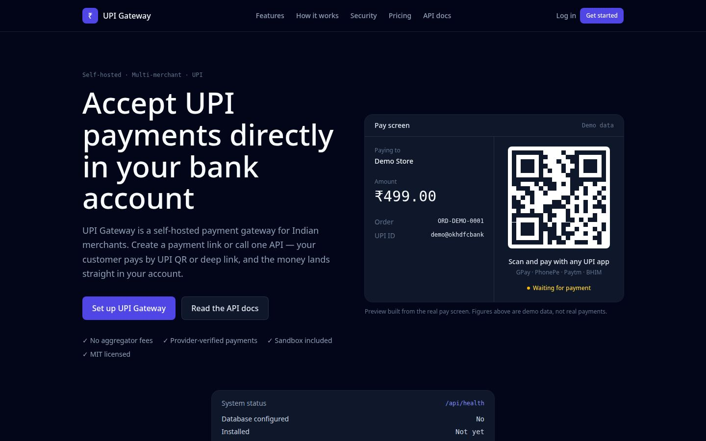
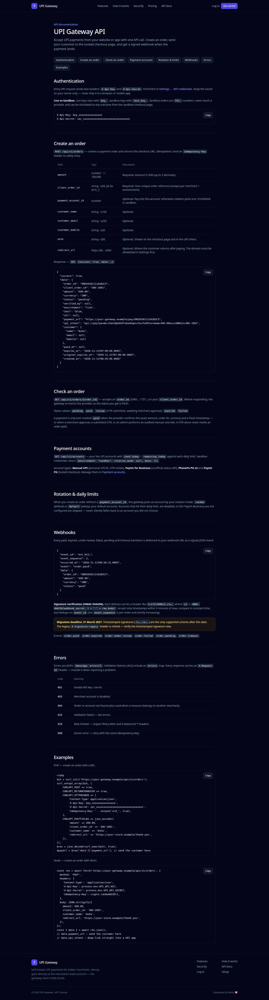
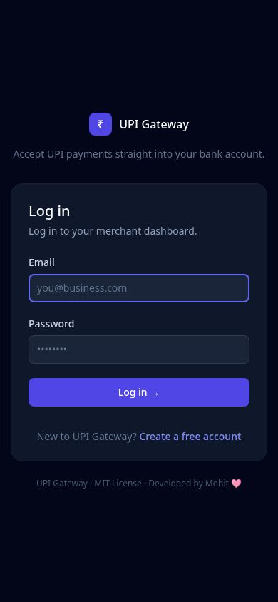
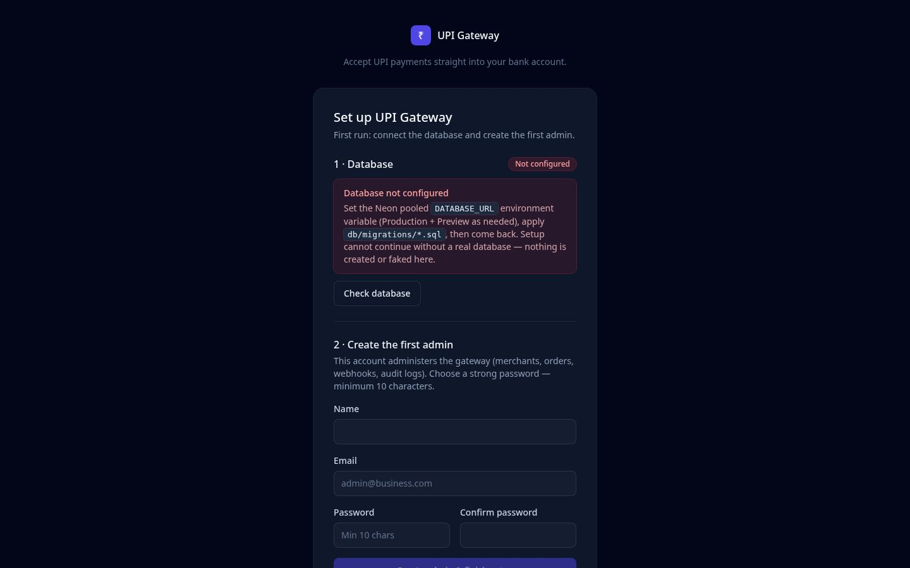

# UPI Gateway


A self-hosted, multi-merchant **UPI payment gateway for Indian merchants** — Next.js 16 + TypeScript (App Router) on Vercel with **Neon Postgres**. A port of the Laravel 12 original ([`mynkdev-21/upi-gateway`](https://github.com/mynkdev-21/upi-gateway), MIT, commit `7189511`). No Supabase anywhere. No Laravel/PHP.

**Live demo:** <https://upi-gateway-gamma.vercel.app> · **Repository:** <https://github.com/lostingness/UPI>

---

## What it is

UPI Gateway lets a merchant accept UPI payments through their **own** UPI ID or payment-gateway account. A customer pays by QR code or deep link, and the money lands **straight in the merchant's own bank account** — the gateway never holds, pools, or settles funds. It only verifies the payment and notifies the merchant's system.

It is built for:

- **Small merchants and shops** who want a payment link or QR without paying an aggregator's per-transaction commission.
- **Developers** who want a clean `POST /api/v1/orders` API, signed webhooks, and a sandbox to test against — no real money, no provider calls.
- **Anyone who wants to own their data** — orders, accounts, and audit logs live in your own Neon Postgres database.

### The one rule everything else follows

> **A payment is never trusted from the customer, the browser, or a UTR alone.**

An order is marked `paid` only when **all** of these match a provider response — exact amount, order ID, currency (`INR`), and a fresh timestamp — or when the merchant approves a customer-submitted UTR against their bank statement, or when an admin performs an audited manual override. A 12-digit UTR typed into a form proves nothing by itself; it goes to review until a human approves it.

---

## Features

| Area | What you get |
|---|---|
| **Orders** | Create from the dashboard or one API call. Live orders are `ORD…`, sandbox orders are `TST…`. Amounts ₹1–₹1,00,000, 2-decimal paise precision. 15-minute default expiry. |
| **QR payments** | Two QR methods — **Unique Amount QR** and **Same Amount QR** (see below). QR rendered in code on the pay screen, with a countdown and UPI deep link (`upi://pay?...`). |
| **Payment accounts** | Manual UPI ID (UTR review), Paytm for Business (unofficial status API), PhonePe PG v2, and Paytm PG (hosted checkout). Rotation (`random` / `default`) with per-account daily limits. |
| **Verification** | Provider status re-checks (exact amount + order ID + currency + timestamp-bound evidence), UTR approve/reject, late-payment grace handling, verification leases. |
| **Webhooks** | HMAC-SHA256 timestamped signatures (`t=…,v1=…`), per-order sequencing, exactly-once-ish delivery via a durable outbox, retry backoff, admin retry/restore. |
| **Sandbox** | Test keys (`test_key_…`) create `TST…` orders that never touch a provider, with a simulator for six outcomes: success, failure, pending, expiry, timeout, invalid reference. |
| **Admin** | Merchant management, all orders, webhook history, audit logs, transaction debugger, verification-lease recovery — all behind a password-confirmed (15-minute window) admin role. |
| **Multi-merchant** | Every merchant sees only their own orders, accounts, and settings. API keys and webhook secrets are per merchant, encrypted at rest (AES-256-GCM). |

---

## Screenshots

Captured 11 November 2026 from a real local production build (`next build` + `next start`) with Playwright at desktop 1440 px and a true phone width of 390 px. No mockups, no AI-generated images. The pay screen, dashboard, QR settings, and order detail with real data need a connected database, so they are not shown here yet — see the note below the gallery.

### Landing page



*Landing page hero (desktop, 1440 px). The pay-screen preview shows clearly labelled demo data — never real payments.*


*Full landing page (desktop): features, Unique vs Same Amount QR, gateway-vs-aggregator comparison, security, demo dashboard preview, API example, pricing, FAQ. The system-status card reads "Database not configured" here because this capture ran without a database — see the note below.*


*Landing page hero at a true phone width (390 px).*


*Full landing page at 390 px. Measured `document.scrollingElement.scrollWidth` is exactly **390** on every page tested — no horizontal overflow.*

### API documentation



*Public API docs (`/docs`, desktop): authentication, order creation, webhooks, errors, PHP + Node examples.*


*API docs at 390 px. Wide tables scroll inside their own card (`scrollWidth` up to 799 px inside a 358 px container) while the page itself stays at 390 px — no page-level horizontal scroll.*

### Login, setup, and the mobile menu


*Login page (desktop).*



*Login page at 390 px.*



*First-run setup (`/setup`, desktop): step 1 checks the database, step 2 creates the first admin. Without a database it honestly reports "Not configured" and refuses to invent one.*


*Setup page at 390 px.*


*Mobile navigation menu open at 390 px. Verified in the capture run: the Menu button opens the menu (`aria-expanded="true"`, links visible) and closes it again (`aria-expanded="false"`).*

### Pay page — error state


***Error state, not a successful payment screen.** Visiting `/pay/ORD-DOESNOTEXIST` in this database-less capture shows "Database not configured" — the pay page cannot look up any order until the Neon database is connected, so it says so instead of faking a result. With a database connected, a genuinely missing order shows "Order not found". A real pay screen with a live QR is deferred to the database-backed capture below.*

### Screenshots still to come (database-backed run)

These screens cannot be captured honestly without a database — the app redirects to `/login` without a session and needs real Neon rows for real data — so they are **deferred, not faked**:

- Merchant **dashboard** (real totals, real recent orders)
- **QR settings** (Settings → QR: method + increment)
- **Pay screen with a real order and QR**
- **Order detail** page (status, verification history, webhook deliveries)

They will be added from a run against a configured Neon database.

---

## QR payments: Unique Amount QR vs Same Amount QR

Every order gets its own QR with the exact amount encoded. Two methods exist (migration `013`, `lib/orders/allocations.ts`); the merchant picks one in Settings → QR, or the platform defaults in `.env` apply.

### Same Amount QR (default)

Every QR shows the order amount — ₹499.00 for one customer, ₹499.00 for the next. No allocation row is created; the payable amount equals the order amount. Best for a counter, a printed sign, or a fixed price (a ₹99 item, a ₹299 ticket, a ₹101 donation). Matching relies on the order reference (`tr` for non-manual accounts, UTR review for manual ones) — amounts alone cannot distinguish two same-amount orders.

### Unique Amount QR

Each live order gets a **distinct payable amount a few paise above the order amount** — e.g. ₹500.00 → ₹500.01, ₹500.02, … — so a payment can be matched to its order by amount alone. Best for online checkout and payment links.

How allocation works:

- **Integer paise arithmetic only.** All money math is `Math.round(amount × 100)`; floats are never added. An amount that is not representable to 2 decimal places (e.g. ₹500.005) is rejected with 422, never silently rounded.
- **Atomic single-statement claim.** The Neon HTTP driver cannot hold a connection across awaits, so there are no multi-statement `FOR UPDATE` transactions. Allocation is one conditional statement — `INSERT … SELECT … WHERE NOT EXISTS (an active allocation for this merchant + account + amount)` — and the caller checks the affected-row count. A 0-row insert means another order already holds that amount, so the next candidate is tried.
- **Partial unique index as the second guard.** `upi_amount_allocations` carries a unique index on `(user_id, COALESCE(payment_account_id, -1), payable_amount) WHERE status = 'active'`. If two concurrent claims both pass the `NOT EXISTS` check, the index rejects one with a unique violation, which is caught and treated as a retry signal — never as an error. No duplicate active allocation can survive both guards.
- **Release on expiry / paid / failed.** When an order is paid, expires, or fails, its allocation moves `active → released` (kept for audit) and the amount becomes available again. Uniqueness is scoped per merchant + payment account, and only while an allocation is active — two merchants can legitimately receive the same payable amount.
- **Hard caps, honest failure.** A unique amount is never more than **₹1.00** above the base amount, and allocation tries at most **100 candidates** by default (`GATEWAY_QR_MAX_ALLOCATION_ATTEMPTS`). When every candidate in that window is taken, order creation fails with **409** and no order row is left behind — it never silently falls back to a duplicate amount. The increment is 1–99 paise (`GATEWAY_QR_INCREMENT_PAISE`, default `1`).

### Limitations — read before relying on Unique Amount QR

- **UPI `am` supports 2-decimal paise precision**, so ₹500.01 is a real amount encoded in the QR and in the intent URL — not a display trick.
- **For manual (P2P) accounts the intent omits `tr`** (NPCI guidance — consumer UPI apps reject it), so there is no provider-side order reference. The unique amount is the **only** mapping signal for manual payments, and **auto-confirmation is impossible without a provider status API or a merchant UTR approval**: the gateway cannot see a manual payment on its own. A unique amount lets the merchant match a bank-statement entry to an order by amount; it does not confirm the payment by itself.
- **A customer can edit the amount in their UPI app before paying.** If the paid amount differs from `payable_amount`, verification **must** reject it (amount mismatch) and the order stays pending/review — the gateway never marks paid on a wrong amount, and never silently accepts the order amount when a different amount was paid.
- **Paytm for Business is unofficial.** If its status API does not return an exact amount, verification cannot confirm by amount and stays pending; the order is then resolved only by merchant UTR approval or admin override. The same applies to any provider response that omits the amount.

---

## Technology stack

| Layer | Choice |
|---|---|
| Framework | Next.js 16 (App Router) + TypeScript 5.9 + React 19 |
| Styling | Tailwind CSS v4 |
| Database | Neon Postgres (serverless HTTP driver, `@neondatabase/serverless`) |
| Auth | Stateless signed JWT (jose HS256) in an `httpOnly` cookie — no sessions table |
| Passwords | bcryptjs |
| Validation | zod |
| QR rendering | `qrcode` (rendered in code on the pay screen) |
| Hosting | Vercel (serverless, no persistent storage, no queue worker) |
| Tests | Vitest (mocked unit tests; see [Tests](#tests)) |

## Architecture

- **Serverless, no long-lived anything.** No filesystem storage, no queue worker, no persistent connections. The Neon HTTP driver opens a connection per query.
- **No multi-statement transactions.** Atomicity comes from single-statement conditional `UPDATE`s (status guard in `WHERE`, affected-row check) and idempotent outbox `INSERT`s (unique `transition_key`, `ON CONFLICT DO NOTHING`).
- **In-memory + Neon-table rate limits and cache.** Best-effort per-instance buckets backed by durable Neon tables (`upi_rate_limits`, `upi_cache`, migration `012`). No Upstash / Vercel KV required for a first deploy.
- **Webhooks without a worker.** The dispatcher cron delivers directly inside the cron invocation, with the same claim/lease, generation fencing, retry backoff, and reconciliation as the Laravel source.
- **Cron limits on Hobby.** Vercel's Hobby plan allows at most **one cron run per day**, so the shipped schedules are once-daily (01:00 order checks, 02:00 webhook dispatch, 03:00 offload, 04:00 prune). The Laravel source ran these every minute; upgrade to Pro to restore per-minute schedules (`* * * * *`). Webhooks can also be dispatched on demand via `POST /api/webhooks/outbox/dispatch` (admin/cron) or the admin UI retry.
- **Lazy table creation.** If `npm run migrate` has not been run, the app creates the tables it needs on first use (`CREATE TABLE IF NOT EXISTS`, guarded once per process). The migration files in `db/migrations/` are canonical for fresh installs.
- **Installed detection.** An `installation_guards.primary_admin` row plus an admin user in Neon — no filesystem markers, no `.env` writes on Vercel.
- **Residual DNS-rebind note.** PHP pinned the socket with `CURLOPT_RESOLVE`; `fetch` has no equivalent. This port re-validates webhook URLs (fresh DNS, all answers public) immediately before sending — see `lib/webhooks/send.ts`.

---

## Installation

```bash
git clone https://github.com/lostingness/UPI.git
cd UPI
npm install
cp .env.example .env.local   # fill in real values (never commit .env.local)
npm run migrate              # applies db/migrations/*.sql to Neon DATABASE_URL
npm run dev                  # http://localhost:3000
```

First run: open `/setup` and create the first admin (or `POST /api/setup` with `{name, email, password, password_confirmation}` — 409 once installed). Or run `DATABASE_URL=... npx tsx scripts/create-admin.ts admin@example.com "Admin"`.

### Environment configuration

See `.env.example` — placeholders only, never real values. The values you must supply:

| Key | Notes |
|---|---|
| `DATABASE_URL` | Neon **pooled** connection string. Sensitive Vercel env var; never in the repo. |
| `SESSION_SECRET` | Session JWT signing secret. Generate fresh at deploy: `openssl rand -base64 48`. |
| `ENCRYPTION_KEY` | 32-byte key (base64/hex) for stored credentials/secrets (AES-256-GCM). `openssl rand -base64 32`. |
| `CRON_SECRET` | Protects `/api/cron/*`. `openssl rand -hex 32`. |
| `APP_URL` | Public URL of the deployment. |
| `ALLOW_REGISTRATION` | `false` (default). Set `true` only to open merchant signups. |

Optional / tuning: `GATEWAY_ORDER_EXPIRY_MINUTES` (15), `GATEWAY_ORDER_CREATE_API_KEY_RATE_LIMIT` (1000), `GATEWAY_API_KEY_RATE_LIMIT` (120), `GATEWAY_API_IP_RATE_LIMIT` (600), `GATEWAY_API_FAILED_AUTH_IP_RATE_LIMIT` (30), `GATEWAY_LATE_PAYMENT_GRACE_HOURS` (24), `GATEWAY_VERIFICATION_LEASE_SECONDS` (120), `GATEWAY_EVIDENCE_REQUIRE_TIMESTAMP` (true), `GATEWAY_EVIDENCE_MAX_AGE_SECONDS` (86400), `GATEWAY_ENABLE_PAYTM_BUSINESS` (true — disable to block the unofficial Paytm Business status endpoint), `GATEWAY_QR_METHOD` (`same` / `unique`), `GATEWAY_QR_INCREMENT_PAISE` (1–99, default `1`), `GATEWAY_QR_MAX_ALLOCATION_ATTEMPTS` (default `100`), `WEBHOOK_OUTBOX_BATCH_SIZE` (100), `WEBHOOK_RETENTION_DAYS` (30). Full list in `.env.example`.

**Paytm MID / merchant key and PhonePe `client_id` / `client_secret` / `client_version` are per payment account** — entered in the dashboard and encrypted in the DB, not env vars. Leave the provider env placeholders empty until real credentials are supplied; with no credentials configured the verifiers return "provider not configured" / pending — **no fake payments, ever**.

### Database setup

Create a Neon Postgres project (Neon has a free tier with limits — check their current pricing before relying on it) and set its **pooled** connection string as `DATABASE_URL`. Then apply the migrations — 001–014, plain SQL, idempotent (`CREATE TABLE IF NOT EXISTS` / `CREATE INDEX IF NOT EXISTS`), re-runnable safely:

```bash
npm run migrate        # records applied versions in schema_migrations
# or psql: for f in db/migrations/*.sql; do psql "$DATABASE_URL" -f "$f"; done
# or paste each file in order into the Neon SQL editor
```

See [`db/README.md`](db/README.md) for the full table map and the MySQL → Postgres conversions.

| Migrations | Tables |
|---|---|
| 001 | `users` |
| 002 | `payment_accounts` |
| 003 | `orders` (incl. UTR + verification-lease columns) |
| 004 | `webhook_logs` |
| 005 | `webhook_outbox` |
| 006 | `admin_audit_logs` (append-only) |
| 007 | `verification_nodes` (kept for compat; not actively maintained on Vercel) |
| 008 | `verification_lease_recovery_audits` (append-only) |
| 009 | `installation_guards` (`primary_admin` row = "installed" marker) |
| 010 | `archived_webhook_logs`, `archived_webhook_payloads` |
| 011 | Performance indexes |
| 012 | `upi_rate_limits`, `upi_idempotency_keys`, `upi_login_attempts`, `upi_cache`, `schema_migrations` |
| 013 | `upi_amount_allocations` (Unique Amount QR), `orders.payable_amount`, `users.qr_method` + `users.qr_increment_paise` |
| 014 | Audit fixes: order/webhook indexes, `upi_idempotency_keys.expires_at` (24 h claim/response expiry, pruned by the prune cron) |

Not migrated as tables: Laravel `cache`/`cache_locks`, `jobs`/`job_batches`/`failed_jobs`, `sessions`, `password_reset_tokens`. Sessions are stateless JWT cookies; the queue is Vercel Cron + direct delivery; no password-reset flow exists in the source and none is invented. Money is `NUMERIC(12,2)`; timestamps are `TIMESTAMPTZ` (UTC in the DB, IST at display).

### Admin configuration

- The first admin is created at `/setup` (name, email, password — minimum 10 characters). After that, `/setup` returns 409.
- Merchant self-registration is off by default (`ALLOW_REGISTRATION=false`).
- Admin pages additionally require `role=admin` **and** a password confirmation within the last 900 seconds (15 minutes).

---

## API documentation

Full interactive reference: [`/docs`](https://upi-gateway-gamma.vercel.app/docs) on the live site. Summary below.

### Authentication

Every API request sends two headers — `X-Api-Key` and `X-Api-Secret` — found in Settings → API credentials. Keep the secret on your server only; never ship it in a browser or mobile app. Live keys start with `key_`, sandbox keys with `test_key_`. Sandbox orders are `TST…`, never touch a provider, and can be simulated to any outcome.

### Create an order

`POST /api/v1/orders` (alias: `POST /api/orders`). Idempotent — send an `Idempotency-Key` header and retries are safe. Rate limited per key (1000/min for order creation) and per IP (600/min).

```bash
curl -X POST $APP_URL/api/v1/orders \
  -H "X-Api-Key: $UPI_API_KEY" \
  -H "X-Api-Secret: $UPI_API_SECRET" \
  -H "Idempotency-Key: order-1001" \
  -d '{
    "amount": "499.00",
    "currency": "INR",
    "client_order_id": "order-1001",
    "customer": { "name": "Asha Verma", "email": "asha@example.com" },
    "redirect_url": "https://shop.example.com/thanks"
  }'
```

| Field | Type | Notes |
|---|---|---|
| `amount` | number · 1–100,000 | Required. INR, up to 2 decimals. |
| `client_order_id` | string · ≤64, `[A-Za-z0-9_-]` | Required. Your unique order reference (unique per merchant + environment). Reusing one returns **409**. |
| `payment_account_id` | number | Optional. Pay into this account; otherwise rotation picks one. Prohibited in sandbox. |
| `customer_name` / `customer_email` / `customer_mobile` | string | Optional (≤100 / ≤255 / ≤20). |
| `note` | string · ≤50 | Optional. Shown on the checkout page and in the UPI intent. |
| `redirect_url` | https URL · ≤500 | Optional. The domain must be allowlisted in Settings first. |

Response — `201 {success: true, data: …}`:

```json
{
  "success": true,
  "data": {
    "order_id": "ORD20261111A1B2C3",
    "client_order_id": "INV-1001",
    "amount": "499.00",
    "currency": "INR",
    "status": "pending",
    "verified_by": null,
    "environment": "live",
    "test": false,
    "utr": null,
    "payment_url": "https://your-gateway.example/pay/ORD20261111A1B2C3",
    "upi_intent": "upi://pay?pa=merchant@okhdfcbank&pn=Your%20Store&am=499.00&cu=INR&tn=INV-1001",
    "customer": { "name": "Asha", "email": null, "mobile": null },
    "paid_at": null,
    "expires_at": "2026-11-11T07:00:00.000Z",
    "original_expires_at": "2026-11-11T07:00:00.000Z",
    "created_at": "2026-11-11T06:45:00.000Z"
  }
}
```

Every API response carries an `X-Request-Id` header — include it when reporting a problem. Response envelope: `{success: true, data: …}`; errors `{message, errors?}`. Public URLs carry `order_no` (`ORD…` live, `TST…` sandbox), never the numeric id.

### Other endpoints

- `GET /api/health` — `{status, database_configured}` (no secrets).
- `GET /api/v1/orders/[orderNo]` — accepts an `order_no` or your `client_order_id`. Re-checks the provider before responding, so the status is fresh. Statuses: `pending`, `paid`, `review` (UTR submitted, awaiting approval), `expired`, `failed`.
- `GET /api/v1/accounts` — your live UPI accounts with `used_today` / `remaining_today` against each daily limit.
- Session-authenticated merchant reads (merchant-scoped, never another merchant's data): `GET /api/orders` (list, `status`/`q`/`environment`/`page`, 20/page + status counts), `GET /api/orders/[orderNo]` (full detail incl. webhook history), `GET /api/dashboard/stats` (`?environment=live|sandbox`, IST stats), `GET /api/settings`.
- Checkout (public): `GET /api/pay/[orderNo]/status` (returns `redirect` only when the order is paid **and** its `redirect_url` passes the merchant's allowlist), `POST /api/pay/[orderNo]/utr`, `POST /api/pay/[orderNo]/start`, `GET+POST /api/pay/[orderNo]/return` (ignores PG-posted data, re-checks), `GET /api/pay/[orderNo]/qr` (PNG, `private, max-age=600`). Checkout polling: every 4 s (pending/review) or 30 s (expired/recovering).
- Sandbox: `POST /api/sandbox/pay/[orderNo]/simulate`.
- Auth: `POST /api/auth/login`, `POST /api/auth/logout`, `POST /api/auth/register` (flag-gated), `POST /api/auth/confirm-password`.
- Admin (session + role=admin + password confirmed within 900 s): orders, merchants, accounts, webhooks (retry / restore-payload), audit logs, transaction debugger, verification-lease recovery, manual payment override (audited).
- `POST /api/webhooks/inbound/[provider]` — **410**: no inbound webhooks exist in the source; provider callbacks land on the pay return URL only.
- `POST /api/orders/[orderNo]/mark-paid` — **disabled stub**, always returns the source's error message. There is deliberately no "just mark it paid" API.

Error codes: `401` invalid key/secret · `403` merchant disabled (or a resource belongs to another merchant) · `404` order/account not found · `409` duplicate `client_order_id` / no unique amount available · `422` validation failed (see `errors`) · `429` rate limited (respect `Retry-After` and `X-RateLimit-*`) · `500` server error (retry with the same `Idempotency-Key`).

---

## Webhooks

Every paid, expired, under-review, failed, pending, and timeout transition is delivered to your webhook URL as a signed JSON event:

```json
{
  "event_id": "evt_01J…",
  "event_sequence": 3,
  "occurred_at": "2026-11-11T06:50:12.000Z",
  "event": "order.paid",
  "data": { "order_id": "ORD20261111A1B2C3", "amount": "499.00", "currency": "INR", "status": "paid" }
}
```

Events: `order.paid`, `order.expired`, `order.under_review`, `order.failed`, `order.pending`, `order.timeout`.

**Signature verification (HMAC-SHA256).** Each delivery carries a header like `t=1731300612,v1=…` where `v1 = HMAC-SHA256(webhook_secret, t + "." + raw_body)`. Accept only timestamps within **5 minutes** of now, compare in constant time, and dedupe on `event_id` (the `event_sequence` is per-order and strictly increasing).

> **Migration deadline: 31 March 2027.** Timestamped signatures (`t=…,v1=…`) are the only supported scheme after this date. The legacy `X-Signature-Legacy` header is retired — verify the timestamped signature now.

**Delivery and retries.** Events are written to a durable outbox (`webhook_outbox`, unique `transition_key`) and delivered by the dispatcher cron, with claim/lease and generation fencing so two invocations never deliver the same event twice. On failure the next attempt is delayed with backoff — **30 s, 2 min, 10 min, 30 min, 1 h** — for up to 6 tries. Failed deliveries can be retried from the admin UI, and the original payload can be restored. Webhook logs are retained 30 days by default (`WEBHOOK_RETENTION_DAYS`), then offloaded to archive tables by the prune cron.

---

## Vercel deployment

1. Import the repo into Vercel (framework: Next.js).
2. Set `DATABASE_URL`, `SESSION_SECRET`, `ENCRYPTION_KEY`, and `CRON_SECRET` as **sensitive** env vars (Production + Preview as needed). Set `APP_URL` to the deployment's public URL.
3. **Turn SSO protection off** for the project if you want the public landing page, docs, and pay links reachable (Vercel's SSO / Deployment Protection would otherwise gate every page behind a login).
4. Run the migrations against your Neon database (`npm run migrate` with `DATABASE_URL` set, or via the Neon SQL editor).
5. Visit `/setup` and create the first admin.

Crons are declared in `vercel.json` (01:00 order checks, 02:00 webhook dispatch, 03:00 offload, 04:00 prune — once daily on Hobby; per-minute on Pro). Cron endpoints are guarded by `CRON_SECRET` (`Authorization: Bearer …`).

**Costs, stated plainly.** The software itself is free (MIT). Hosting on Vercel's Hobby plan is free with limits (including the once-daily cron limit above); Neon has a free tier with limits. Neither is "free forever" — check their current plans before relying on them. Paytm and PhonePe charge whatever they charge the merchant directly; the gateway adds no fee of its own.

---

## Free self-hosted software — what is and isn't free

- **Free:** this codebase (MIT), every dependency it uses, the sandbox, unlimited merchants, accounts, orders, API calls, and webhooks. No mandatory paid API, template, or library anywhere in the stack.
- **May cost or have free-tier limits:** the services you host it on — Neon Postgres (free tier with limits), Vercel (Hobby free with limits, notably one cron run per day), and your payment providers (Paytm / PhonePe) and bank, which charge the merchant directly.
- **The distinction matters:** "free self-hosted" describes the software, not the infrastructure. You pay your hosting and provider bills; you never pay the gateway.

---

## Troubleshooting

| Symptom | Cause / fix |
|---|---|
| `Database not configured` on the landing page, `/setup`, or `/pay/*` | `DATABASE_URL` is missing or unreachable. Set the Neon **pooled** connection string as a sensitive env var (Vercel) or in `.env.local` (local), then re-check. `GET /api/health` reports `database_configured`. |
| `/setup` returns 409 | The gateway is already installed (a first admin exists). This is by design — setup runs once. |
| `409` on `POST /api/v1/orders` | Either the `client_order_id` was already used for this merchant + environment, or (Unique Amount QR) every payable amount within ₹1.00 of the order amount is currently allocated. For the latter, retry in a few minutes — allocations release when orders expire or are paid. |
| `422` "account not found" on order creation | The `payment_account_id` does not exist or belongs to another merchant. Omit it to let rotation pick an account. |
| `422` "Amount must have at most 2 decimal places" | Amounts are exact to the paise (e.g. `499.00`). `500.005` is rejected, never rounded. |
| Cron endpoints return 401 | The request needs `Authorization: Bearer $CRON_SECRET`. Vercel sends this automatically for scheduled crons configured in `vercel.json`; manual calls must include it. |
| Webhooks not arriving | Check the outbox: admin → Webhooks shows each event's attempts. On Hobby, dispatch runs once daily (02:00) — use `POST /api/webhooks/outbox/dispatch` (admin) or the admin UI retry to dispatch on demand. |
| Orders stay pending after a manual UPI payment | Expected without a provider API: manual payments cannot be seen by the gateway. The customer submits their UTR, and the merchant approves it in the dashboard (or a Unique Amount QR lets the merchant match the bank-statement amount to the order). |
| Tables missing after deploy (first-use errors) | Run `npm run migrate`. Most tables are also created lazily on first use, but the migration files are canonical — run them once per fresh database. |
| `mark-paid` always errors | Deliberate. That route is a disabled stub returning the source's error message — there is no API that marks an order paid without evidence. Use UTR approval or the audited admin override instead. |

---

## Tests

```bash
npm test            # vitest run
```

All tests in `tests/` are **mocked** (pure crypto/validation, injected fetch, in-memory idempotency store). They cover: PaytmChecksum (incl. a fixed-salt known vector), webhook HMAC signature (valid / tampered / stale), SafeUrl SSRF rules, UTR-alone-does-not-mark-paid + evidence bindings, order-creation idempotency, authz boundary, and the three verifiers (paid only on all bindings). **Live tests against the real Neon database are still owed**: create order → sandbox simulate success → webhook delivered + signed → order paid; provider verify rejects wrong amount; UTR approve/reject; admin override; rate limits (401/403/429); installer blocked after install; outbox retry after failure.

---

## Security considerations

- **Never mark paid on UTR alone.** A UTR is a claim, not proof. Only a provider response binding amount + order ID + currency + a fresh timestamp, a merchant UTR approval, or an audited admin override marks an order paid. The `mark-paid` API is a disabled stub.
- **Provider evidence bindings.** Verification requires the exact amount, order ID, currency, and a timestamp within the configured window (`GATEWAY_EVIDENCE_MAX_AGE_SECONDS`, default 24 h, with 5 min clock skew). A wrong amount is rejected, never silently accepted.
- **Webhook signing.** HMAC-SHA256 over `timestamp + "." + raw_body`, 5-minute tolerance, constant-time comparison, dedupe on `event_id`. Legacy `X-Signature-Legacy` retires 31 March 2027.
- **SSRF hardening.** Webhook and redirect URLs are re-validated immediately before sending — fresh DNS resolution, all answers must be public IPs (no private / loopback / link-local ranges). `GATEWAY_WEBHOOK_ALLOW_INSECURE` / `GATEWAY_ALLOW_INSECURE_REDIRECTS` exist for local dev only and must stay `false` in production.
- **Redirect allowlist.** A customer returns only to a domain the merchant allowlisted in Settings. Anything else is refused, and the pay-status endpoint returns `redirect: null`.
- **Rate limits.** Order creation: 1000/min per API key, 600/min per IP; general API: 120/min per key; failed-auth: 30/min per IP. Idempotency keys are stored for 24 h and pruned by the cron.
- **Sessions.** Stateless signed JWT (HS256) in an `httpOnly`, `Secure`-in-production, `SameSite=lax` cookie (`upi-gateway-session`), **120-minute** lifetime. The token embeds a prefix of the password hash, so a password change invalidates all sessions. Admin actions additionally need a password confirmation within the last 15 minutes.
- **Secrets at rest.** Provider credentials and API secrets are stored AES-256-GCM encrypted in the merchant's own database (`ENCRYPTION_KEY`). They are never logged and never returned by any API.
- **Auditing.** Manual payment overrides, verification-lease recovery, and admin actions are written to append-only audit logs with who did it and why.
- **What this is not.** There is no password-reset flow (the source never had one, and none was invented). The Paytm Business status API is unofficial and may change without notice. And no part of this codebase will ever fabricate a payment: with no provider credentials configured, verification returns "provider not configured" and orders stay pending.

---

## License

MIT — Copyright (c) 2026 Mayank Singh; Copyright (c) 2026 Mohsin Khan. See [`LICENSE`](LICENSE).

## Credits

- Original Laravel 12 project: [`mynkdev-21/upi-gateway`](https://github.com/mynkdev-21/upi-gateway) (MIT) — this is a Next.js + TypeScript + Neon Postgres port of that work, preserving its verification rules, webhook format, and API shape.
- Design approach follows the **Unslop** method by Damir Sokolovsky ([unslop](https://github.com/heydamir/unslop), CC BY 4.0) — original design, no slop.
- The live deployment, redesign, and this port were built for the merchant-facing release by Mohit.

---

<p align="center"><sub>Developed by Mohit 🩷</sub></p>
